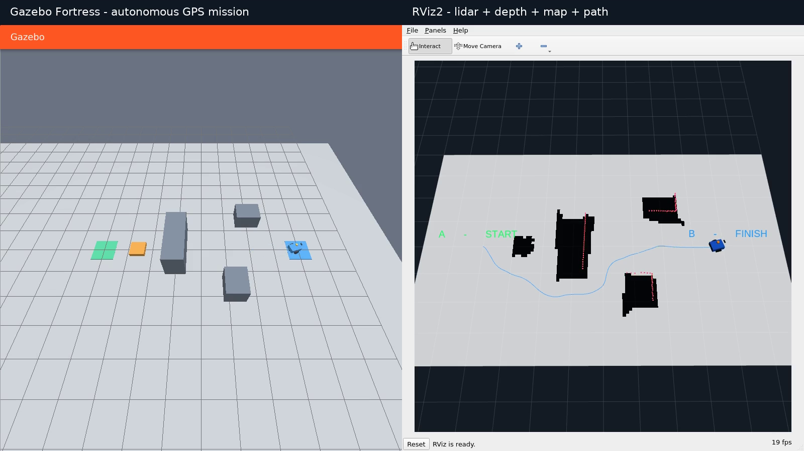

# Автономный мобильный робот: Gazebo + ROS 2

Робот самостоятельно проходит из зоны **A (0, 0)** в **B (8, 0)** по двум GPS waypoint-точкам, объезжая статические препятствия. Лидар и камера глубины дополняют карту препятствий; GPS участвует в локализации и выборе целей. Движение, датчики и столкновения моделируются в Gazebo Fortress.


**Среда: Ubuntu 22.04 amd64, ROS 2 Humble, Gazebo Fortress.**

## Быстрый запуск

Поддерживаемая среда: **Ubuntu 22.04 amd64**, обычный Linux-десктоп или WSL2 с WSLg. В терминале Ubuntu перейдите в корень клонированного или распакованного проекта. Папка может находиться в любом доступном для записи месте; запуск от root не требуется.

Установка зависимостей (один раз; требует sudo):

```bash
bash scripts/install_deps.sh
```


После установки — запуск:

```bash
bash scripts/run.sh
```

Откроются Gazebo и RViz2; после получения свежих данных датчиков робот начнёт движение автоматически. После достижения B робот остаётся остановленным. Завершение — `Ctrl+C` в терминале.

Тесты и явная пересборка после изменений:

```bash
bash scripts/build.sh
```

Нужен X11/OpenGL-дисплей. В WSL2 дисплей предоставляет WSLg. По умолчанию включён Mesa software OpenGL для совместимости Ogre2 с WSLg. При исправном аппаратном OpenGL можно задать `LIBGL_ALWAYS_SOFTWARE=0` перед командой запуска.

## Автоматическая проверка без рабочего стола

```bash
bash scripts/check_run.sh
```

Если `DISPLAY` отсутствует, скрипт автоматически создаст временный Xvfb-дисплей. Окна GUI отключены, физика и реальные датчики Gazebo продолжают работать. Код завершения 0 означает, что все 18 условий выполнены; отчёт, траектория и журнал сохраняются в новом каталоге `artifacts/check-*`. Можно задать собственный каталог первым аргументом; существующий отчёт не перезаписывается.

При остановке симуляции (`Ctrl+C`) `ros_gz_bridge` иногда завершается с кодом `-11`. Это наблюдалось после отчёта `PASS`, при завершении процессов. Падение во время миссии считается ошибкой проверки.

## Демонстрация

[Видео Gazebo + RViz2, 75 секунд](media/demo.mp4)




## Устройство проекта

```text
src/robot_demo/
  urdf/robot.urdf.xacro       модель, массы, инерции, коллизии, датчики, привод
  worlds/demo.sdf            плоский мир, препятствия и зоны A/B
  config/scenario.yaml       географическая привязка, карта, габариты, GPS-цели
  config/bridge.yaml         направления и типы ROS/Gazebo-топиков
  config/demo.rviz           визуализация датчиков, карты, модели и пути
  config/gazebo.config       обзор сцены без закрывающих её панелей
  launch/demo.launch.py      общий запуск всей системы
  robot_demo/core.py         геометрия, GPS, инфляция карты, A*, проекция глубины
  robot_demo/localization.py GPS-привязка одометрии, map → odom, оценка позы
  robot_demo/perception.py   лидар + depth, фильтрация пола, обновление карты
  robot_demo/navigator.py    GPS-waypoints, планирование, слежение, остановка
  robot_demo/validator.py    независимая проверка движения по ground truth
  test/test_core.py          тесты алгоритмов
scripts/                    установка, сборка, проверка, запись видео
docs/                       архитектура, критерии, ответы по электронике
evidence/                   сохранённые результаты проверок
media/                      демонстрационное видео и кадр финиша
```

Мир генерируется `scripts/generate_world.py` из той же конфигурации, что используется для карты. Сгенерированный SDF включён в проект. При изменении географической привязки необходимо согласованно изменить параметры мира и waypoint-точки: в текущем демонстрационном мире datum фиксирован на 55° N, 37° E.

## Как работает навигация

1. Дифференциальный привод Gazebo принимает `/cmd_vel` и публикует `/odom`, колёсные состояния и преобразование `odom → base_link`.
2. `gps_localization` переводит текущие GPS-показания в локальные восток/север, привязывает к ним непрерывную одометрию и публикует `map → odom`. Угол поворота берётся из одометрии. GPS обязательно участвует в оценке позиции.
3. `sensor_mapping` строит OccupancyGrid из известной геометрии высоких препятствий и добавляет реальные наблюдения датчиков. Низкая оранжевая коробка высотой 16 см намеренно отсутствует в исходной карте. Лидар расположен на высоте около 38 см, поэтому коробку должна обнаружить камера глубины.
4. Камера — стандартный RGBD-сенсор. Метрическая depth-картинка проецируется в точки. RANSAC отделяет почти горизонтальную плоскость пола с учётом небольшого наклона корпуса. Точки выше пола попадают в карту и `/depth/obstacles`.
5. Waypoints задаются широтой и долготой в YAML. Перед планированием они переводятся в ту же локальную систему, что текущие GPS-показания.
6. A* работает по сетке 10 см с восемью направлениями, запрещает проход по диагонали через углы препятствий. Занятые клетки расширяются на радиус робота 29 см + запас 22 см. Цель контроллера — последовательно достичь обеих GPS-точек, последняя соответствует B.
7. Контроллер выбирает точку впереди на пути, сначала поворачивается при большом угловом отклонении, затем движется со скоростью до 0.30 м/с. Путь пересчитывается при изменении проходимости и каждые 2 секунды симуляции.
8. Нет свежего лидара, глубины, GPS, позы или карты — публикуется нулевая скорость. Лидар дополнительно блокирует движение вперёд, если препятствие слишком близко. В пределах 20 см от последней цели миссия завершается и скорость остаётся нулевой.

Вместо SLAM используется разрешённый заданием вариант с известной картой, дополненной измерениями. Карта накапливает наблюдения: это соответствует статическим препятствиям; удаление динамических препятствий здесь не реализовано. GPS задан без искусственного шума.

## ROS-интерфейсы

| Топик | Тип / роль |
|---|---|
| `/scan` → `/lidar/scan` | `LaserScan`, реальные измерения лидара, нормализованный frame |
| `/camera/depth_image` → `/depth/image` | `Image`, метрическая глубина |
| `/camera/image` → `/rgb/image` | `Image`, цветная картинка |
| `/depth/obstacles` | `PointCloud2`, препятствия камеры после удаления пола |
| `/gps/fix` | `NavSatFix`, GPS |
| `/odom` | `Odometry`, одометрия привода |
| `/localization/pose` | `PoseStamped`, GPS-привязанная поза |
| `/map` | `OccupancyGrid`, карта для планирования |
| `/plan` | `Path`, текущий маршрут A* |
| `/trajectory` | `Path`, пройденный путь |
| `/cmd_vel` | `Twist`, управление приводом |
| `/mission/status` | `String` с JSON, состояние миссии |
| `/contacts` | `Contacts`, реальные контакты из физики Gazebo |
| `/ground_truth/poses` | `TFMessage`, независимые координаты Gazebo **только для проверки** |
| `/clock`, `/tf`, `/tf_static`, `/joint_states` | время симуляции и модель |

Дерево преобразований: `map → odom → base_link → lidar_link / camera_link → camera_optical_frame / gps_link`. Оптическая система камеры соответствует ROS: Z вперёд, X вправо, Y вниз.

## Проверка и видео

```bash
bash scripts/build.sh
bash scripts/check_run.sh artifacts/check-01
bash scripts/check_contacts.sh
bash scripts/install_deps.sh --with-video
bash scripts/record_demo.sh artifacts/my-video
```
Монитор проверяет 18 условий: отдельно проверяет старт/финиш и зазор по координатам Gazebo, GPS-финиш, отсутствие контактов с препятствиями, реальное движение в обход, работающие датчики, обнаружение низкой коробки камерой, карту/путь, цепочку TF, фактическую остановку и устойчивость корпуса. Отчёт и CSV траекторий записываются в `artifacts/...`.

`check_contacts.sh` — **отрицательный интеграционный тест**: робот специально появляется в стене в отдельной симуляции. Успех теста означает, что датчик действительно заметил столкновение; это не демонстрационный проезд.


Результаты и соответствие критериям — [docs/verification.md](docs/verification.md). Пояснение архитектуры — [docs/architecture.md](docs/architecture.md). Бонусные ответы — [docs/electronics.md](docs/electronics.md).


## Источники

- [Gazebo / ROS: совместимые версии](https://gazebosim.org/docs/fortress/ros_installation/)
- [Датчики Gazebo Fortress](https://gazebosim.org/docs/fortress/sensors/)
- [NavSat Fortress](https://gazebosim.org/api/gazebo/6/classignition_1_1gazebo_1_1systems_1_1NavSat.html)
- [ros_gz: ROS-интеграция Gazebo](https://github.com/gazebosim/ros_gz/tree/humble)
- [Графические Linux-приложения WSL](https://learn.microsoft.com/en-us/windows/wsl/tutorials/gui-apps)
