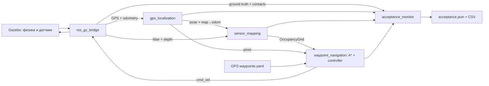

# Архитектура и настройки

ground truth не используется для локализации или управления. Только проверяющий узел получает абсолютную позу из SceneBroadcaster. Навигация использует GPS, одометрию, датчики и карту.

Начало мира — 55° N, 37° E; X направлен на восток, Y на север. На масштабе 12 метров достаточно локальной аппроксимации `x = R cos(lat0) Δlon`, `y = R Δlat`, с углами в радианах.

Две пассивные опоры перед ведущей осью и за ней удерживают платформу в горизонтальном положении.

Параметры выбраны под сцену: сетка 0.1 м; внешний радиус платформы 0.29 м; расширение препятствий ещё на 0.22 м; lookahead 0.35 м; скорость ≤0.30 м/с; угловая скорость ≤0.9 рад/с; допуск цели 0.20 м. Малая длина упреждения ограничивает срезание углов пути. При большом рассогласовании робот сначала поворачивается на месте. Существование пути проверяется до выдачи команды движения.

Измерения камеры в `32FC1` выражены в метрах; также поддержан `16UC1` в миллиметрах. Обрабатываются endian и шаг строки. После прореживания каждые четыре пикселя вычисляются точки по горизонтальному FOV 1.2 рад и разрешению 160×120. Известная геометрия установки камеры используется при проекции. Сегментация пола допускает только почти горизонтальную плоскость рядом с ожидаемой высотой пола; вертикальная стена не может быть удалена как пол. Детектор проверяется тестом с наклонённым полом и низкой коробкой.

Карта представляет статическую сцену с накоплением наблюдений. Известные высокие препятствия задают исходную проходимость, но низкая коробка появляется в карте только после сенсорного наблюдения. Поэтому камера влияет на маршрут даже при наличии исходной карты.

ROS-параметр `use_sim_time` установлен всем узлам. Ограничение свежести датчиков проверяет и время симуляции, и время приёма. При остановке симулятора физическое время модели перестаёт течь; после возобновления навигация ждёт свежие данные.

Все сенсорные подписки используют совместимый best-effort QoS. Карта, маршрут и состояние миссии используют transient-local QoS, чтобы поздно подключённый RViz получил последнее значение.
